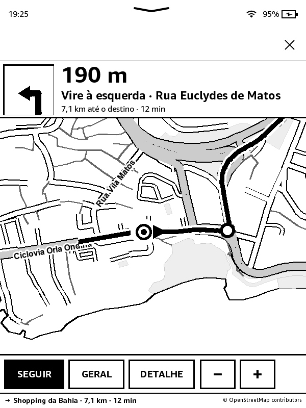
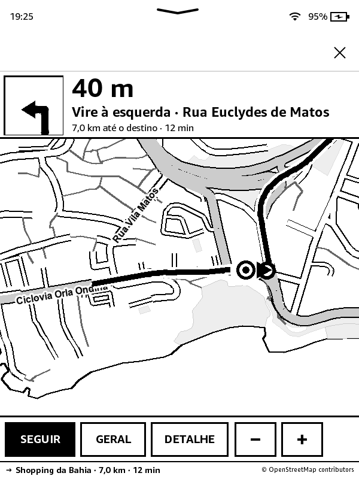
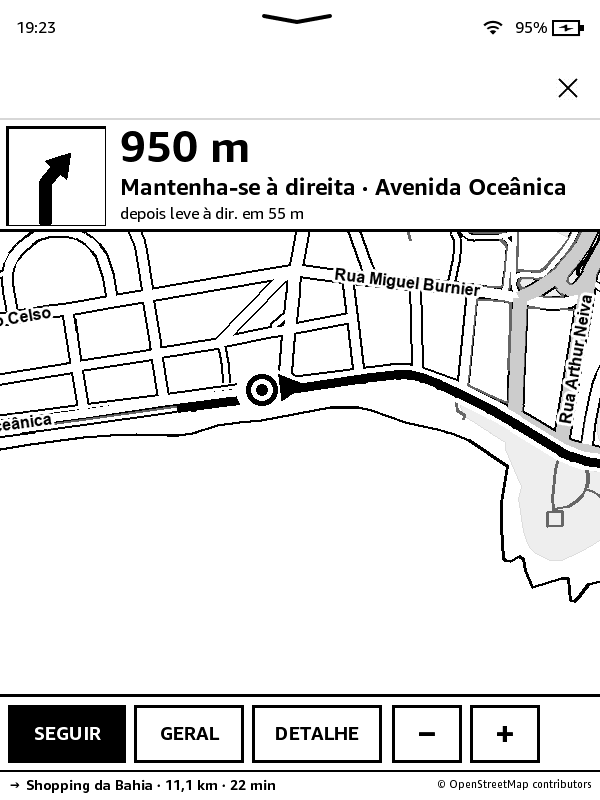

# kindle-osm-nav

Mapa **offline** do OpenStreetMap com **navegação curva a curva** para um Kindle de tinta eletrônica (E Ink), usando o **GPS do celular**. O Kindle não tem GPS nem internet própria: o celular manda a posição pela rede local (hotspot) e o próprio Kindle calcula a rota, desenha o trajeto e mostra a próxima manobra.

<p>
  
  
  
</p>

*Capturas reais da tela do Kindle (`/dev/fb0`), com rota de teste em Salvador.*

> **Mapa auxiliar.** O E Ink tem latência e o toque tem zonas mortas. Na moto ou no carro, use o celular como navegação principal e não interaja com o Kindle com o veículo em movimento.

## Dispositivo validado

| | |
|---|---|
| Modelo | Kindle Basic 10ª geração (2019), **KT4**, Kids Edition |
| Firmware | **5.18.1.1.1** |
| Hardware | i.MX6SLL (1 núcleo, ~1 GHz), 512 MB RAM, tela 600×800, 16 tons de cinza |
| Acesso | Jailbreak **SpringBreak** + **Jobman** (SSH root por Wi‑Fi ou rede USB) |
| Região do mapa | Salvador + Lauro de Freitas (BA) |

Outros modelos ou firmwares **não foram testados**. O app usa o motor web nativo do Kindle (WAF/Mesquite) e não depende do KUAL, do KWebBrew nem do launcher Mesquito, que não cobrem a firmware 5.18.1.1.1.

## Requisitos

- **Kindle:** jailbreak com SSH root (validado com SpringBreak + Jobman). O app usa o que já existe no sistema: Lua 5.1 com cjson, `tcpsvd` (busybox), `iptables` e `eips`.
- **Computador** (para gerar os dados e instalar): Python 3.9+, [Pillow](https://pypi.org/project/Pillow/), `curl`, `ssh`. Testado no macOS.
- **Celular** (fonte do GPS):
  - **Posição:** [OwnTracks](https://owntracks.org/) (Android ou iOS) em modo HTTP, ou [GPSLogger](https://gpslogger.app/) (Android) com "Custom URL";
  - **Rota:** o navegador do celular, para a página de busca de destino.
- **Rede:** hotspot do celular ou Wi‑Fi em comum. A internet só é usada no computador, para baixar os dados do OSM.

## Como funciona

```
celular (OwnTracks/GPSLogger) ──HTTP──▶ receptor gpsd.lua  (tcpsvd :8765, no Kindle)
celular (navegador /nav)      ──HTTP──▶   ├─ nav.lua    progresso, saída da rota, chegada, busca
                                          ├─ router.lua A* offline (bicicleta ou moto/carro)
                                          └─ grava /tmp/kindlemap/location.js e route.js
                                                        │
                                  app WAF (Mesquite) ◀──┘  lê por <script>; tiles z9–17 em /mnt/us
```

- **Mapa:** tiles raster z9–17 (~1 m/px no z17), alto contraste, ruas com contorno e nomes ao longo da via. Gerados no computador a partir de dados brutos do OSM, nunca baixados de `tile.openstreetmap.org`.
- **Rota:** grafo de ruas (84 mil nós) com custos por perfil:
  - **Bicicleta:** respeita mão única salvo contrafluxo liberado, evita vias expressas e escadas, prefere ciclovias;
  - **Moto/carro:** só vias motorizadas, respeitando mão única.

  No KT4, uma rota de 11,7 km sai em ~3,8 s.
- **Na tela:**
  - painel com seta, distância e instrução com nome da rua, mais o aviso "depois…" quando a curva seguinte vem logo em seguida;
  - trajeto em linha preta, com o norte para cima;
  - zoom automático que aproxima e enquadra a curva quando ela chega perto;
  - recálculo automático se você sair da rota e aviso de chegada.
- **Destino:** página `/nav` no celular, com busca offline por rua (com o bairro), bairro ou lugar, sem número de casa.

Detalhes do protocolo em [`docs/protocol.md`](docs/protocol.md). Os achados sobre o KT4/Mesquite que fazem isso funcionar estão em [`docs/device-notes.md`](docs/device-notes.md).

## Estrutura

```
kindle-map/          app WAF (index.html, app-dom.js, config.xml, icons/)
kindle-map/receiver/ gpsd.lua, nav.lua, router.lua, scripts Iniciar/Parar/Atualizar
tools/               osm_extract, build_tiles, build_graph, build_search, build_icons,
                     simulate_android, deploy-ssh, usb-install
docs/                protocolo, notas do dispositivo, medições da etapa 1
```

## Dados do mapa

**Opção A — mapa pronto de Salvador + Lauro de Freitas:** baixe `salvador-lauro-data-*.zip` na página de [Releases](../../releases) e descompacte na raiz do projeto. Isso cria `build/pack` e `build/data`.

**Opção B — gerar os dados** (outra região: ajuste o `BBOX` em `tools/osm_extract.py`):

```sh
python3 -m pip install Pillow
python3 tools/osm_extract.py      # dados brutos OSM via Overpass, em partes (cache em .cache/)
python3 tools/build_tiles.py      # build/pack        tiles z9–17
python3 tools/build_graph.py      # build/data/graph.json   + rota de validação
python3 tools/build_search.py     # build/data/search.json  índice de busca
python3 tools/build_icons.py      # kindle-map/icons        setas de manobra
```

## Instalação no Kindle

1. **Acesso SSH:** pelo Jobman, ative o SSH.
   - **Pelo Wi‑Fi:** o Kindle fica no IP da sua rede.
   - **Pela rede USB do Jobman:** o Kindle aparece no computador como **placa de rede**, não como disco. Configure o computador em `192.168.15.201/24` e acesse o Kindle em `192.168.15.244`.
2. **Primeira vez:** copie `kindle-map/` para o Kindle e rode `sh install-waf.sh`. Ele registra o app `com.lucaslima.kindlemap` no `appreg.db`, depois de fazer backup.
3. **Instalar ou atualizar** app, mapa e receptor:
   ```sh
   tools/deploy-ssh.sh IP_DO_KINDLE --data   # --data envia build/pack e build/data (~50 MB)
   ```
   O `update-waf.sh` copia o app, põe o mapa em `/mnt/us/kindlemap/pack` (ligado ao app por symlink) e instala na biblioteca os atalhos **KindleMap GPS - Iniciar** e **KindleMap GPS - Parar**. Antes, faz backup do app anterior. Não mexe no sistema de arquivos raiz, que continua somente leitura.
4. **Remover:** rode `sh uninstall-waf.sh` e apague `/mnt/us/kindlemap` e os atalhos `kindlemap-*.sh` da pasta `documents/`.

## Uso

1. Conecte o Kindle ao hotspot do celular. Na biblioteca, abra **KindleMap GPS - Iniciar**. Ele:
   - libera a porta 8765, só em memória;
   - inicia o receptor;
   - religa a barra de status (o Jobman a desliga);
   - abre o mapa.

   A barra inferior mostra `IP:8765 · token XXXXXX`.
2. **Posição no celular:**
   - **OwnTracks:** modo HTTP, URL `http://IP:8765/owntracks?token=TOKEN`, monitoramento "Move";
   - **GPSLogger:** Custom URL, método GET, `http://IP:8765/api/update?token=TOKEN&lat=%LAT&lon=%LON&spd=%SPD&dir=%DIR&acc=%ACC`, intervalo de 3–5 s.
3. **Rota:** no navegador do celular, abra `http://IP:8765/nav?token=TOKEN`, busque o destino, escolha **Bicicleta** ou **Moto/carro** e toque no resultado.
4. **Controles na tela:**
   - **+** e **−** ajustam o zoom e desligam o automático;
   - **SEGUIR** religa o automático;
   - **GERAL** e **DETALHE** mudam o nível de zoom.

   Os mesmos controles existem no celular, em `/control?token=TOKEN`.
5. **Ao terminar:** abra **KindleMap GPS - Parar**. Ele fecha a porta, para o receptor e apaga a posição da memória. Reiniciar o Kindle também desfaz tudo.

O Kindle continua dormindo normalmente. Para manter a tela acesa durante o uso, crie o arquivo `/mnt/us/kindlemap/keep-awake`.

**Teste sem celular:**
```sh
python3 tools/simulate_android.py --host IP_DO_KINDLE --token TOKEN \
  --route-to=-12.9783,-38.4553 --profile bike --deviate-at 20
```
O simulador pede a rota, percorre o trajeto como um celular e, no fix 20, sai da rota para testar o recálculo.

## Limites conhecidos

- **Testado só com simulação de celular** no KT4. Ainda falta o teste de rua com celular real.
- **iOS:** o OwnTracks em segundo plano depende da permissão de localização. HTTP sem TLS para IP local não foi testado no iPhone.
- **Qualidade das instruções:** depende dos dados do OSM. Ruas sem nome geram instruções sem nome, e mudanças de grafia são ignoradas.
- **Busca:** não tem número de casa.
- **Atualização da tela:** depois que o mapa recentraliza, o app pede uma atualização completa da tela (`eips -f`), no máximo a cada 4 s. Entre uma e outra, pode sobrar o "fantasma" típico do E Ink.
- **Jobman por cima do mapa:** abrir o Jobman durante o uso desliga a barra de status e o mapa fica por baixo. Rode **Iniciar** de novo.

## Licenças

- **Código:** [MIT](LICENSE).
- **Dados de mapa:** © colaboradores do OpenStreetMap, [ODbL](https://opendatacommons.org/licenses/odbl/). Os mapas gerados mostram a atribuição na tela. Veja [`NOTICE.md`](NOTICE.md).
- Projeto independente, sem afiliação com a Amazon. "Kindle" é marca da Amazon.com, Inc. Jailbreak e alterações no aparelho são por sua conta e risco.
